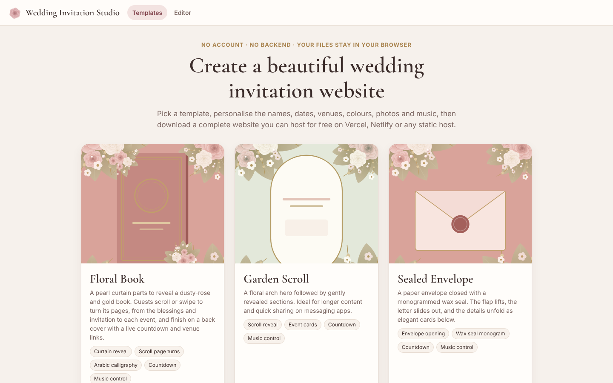
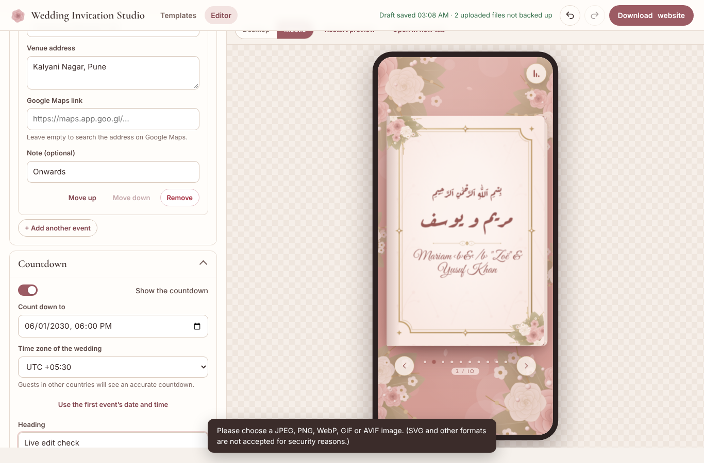

# Wedding Invitation Studio

A client-side generator for animated wedding invitation websites. Pick a
template, personalise it with a live preview, and download a complete static
website you can host for free. There is no database, no backend API, no
account and no build step, and the exported site never contacts the generator.






## Features

- **Template gallery** with previews. Six templates are included:
  - **Floral Book** (main template, modelled on the reference recording):
    a pearl-draped curtain (“Pull the strings to open”) reveals a dusty-rose
    book with a baroque gold oval medallion, Arabic calligraphy and lace
    florals. Guests turn the 3D pages by scrolling, swiping, tapping or with
    the keyboard: monogram page → blessings → invitation → one page per event
    → photo → RSVP → “Awaiting your presence”. The back cover holds the live
    countdown, venue map links and “Open again”. Desktop shows a two-page
    spread.
  - **Sealed Envelope**: tap the monogrammed wax seal, the flap lifts and the
    letter slides out, then the details unfold as cards.
  - **Garden Scroll**: a single scrolling page with reveal animations.
  - **Royal Doors**: carved arched doors swing open onto the couple's names.
    The details continue in arch-topped panels (emerald and gold).
  - **Story Cards**: full-screen story-style slides with progress bars and
    auto-advance. Tap right or left to move, press and hold to pause.
  - **Moonlit Night**: a starry sky with a crescent moon and hanging lanterns
    that light up at a tap. Details glow in gold-framed sections.

  Each template comes with a suggested colour palette. Switching templates
  applies it, unless you have customised your colours.
- **Live editor**: two panels on desktop and Edit/Preview tabs on mobile. The
  preview updates as you type and can be shown at desktop or phone size.
  Undo/redo, reset to sample content, and an unsaved/saved draft indicator.
- **Everything is editable**: couple and parents' names, family introduction,
  heading and message, Qur'an verse or quotation, any number of events (Nikah,
  Walima, Mehndi…) with Gregorian and automatic or manual Hijri dates, times,
  venues, addresses and Google Maps links, countdown with time zone, photos,
  background artwork, colours (with presets), fonts, text size, music, optional
  sections, RSVP contacts, WhatsApp and form links, labels and language.
- **Exports**
  - **ZIP website (recommended)**: `index.html`, `assets/css/style.css`,
    `assets/js/app.js`, `assets/images/`, `assets/audio/`, `assets/fonts/` and
    a `README.md` with hosting steps. All paths are relative, and every
    reference is checked before the download starts.
  - **Single HTML file**: everything is embedded as data URIs. You get a
    warning when the file becomes large.
- **Drafts and backups**: settings are saved to `localStorage` automatically.
  Uploaded files stay in memory only. A project backup (`.json`) includes the
  uploads and can be imported again later.
- **Safe by design**: user text is only ever inserted with `textContent`, and
  links are restricted to `https:`, `tel:` and `wa.me`. Uploads are checked by
  their real content, so SVG and HTML files are rejected. The preview runs in a
  sandboxed iframe, and exported pages ship with a strict Content Security
  Policy.
- **Accessible**: keyboard navigation (arrow keys, Home/End), swipe gestures,
  labelled controls, live page announcements, focus management and a
  reduced-motion fallback that switches to fades and turns off the petals.

## Run the generator locally

The editor is plain HTML, CSS and ES modules. Browsers do not load ES modules
from `file://`, so serve the folder over HTTP:

```bash
npm start            # node tools/serve.mjs  →  http://127.0.0.1:8080/
# or: python3 -m http.server 8080
```

No `npm install` is needed. The repository has no runtime dependencies:
JSZip and the fonts are vendored in `vendor/`.

## Deploy the generator publicly (free)

Once deployed, anyone with the link can create and download their own
invitation. Nothing is stored on the server. Each visitor's work stays in their
own browser, so the generator needs no database and has no running costs
beyond the free static-hosting tier.

`npm run build` copies just the files the generator needs (`index.html`,
`assets/`, `src/`, `templates/`, `vendor/`) into `dist/`. Tests and tooling are
left out. Both hosts below are already configured to use it.

**Vercel** (configured by `vercel.json`)
1. Sign in at https://vercel.com with GitHub.
2. *Add New → Project*, then import `skshoeb26/Wedding`.
3. Keep the detected settings (build `node tools/build-site.mjs`, output
   `dist`) and click **Deploy**. You get a URL like
   `https://wedding-xxxx.vercel.app`.

**Netlify** (configured by `netlify.toml`)
1. Sign in at https://app.netlify.com with GitHub.
2. *Add new site → Import an existing project → GitHub*, then choose
   `skshoeb26/Wedding`.
3. Keep the detected settings (build `node tools/build-site.mjs`, publish
   `dist`) and click **Deploy**.

Both hosts redeploy automatically on every push to the production branch
(`main` by default) and create preview links for pull requests. You can add a
custom domain in either dashboard.

Check the build locally with:

```bash
npm run build && node tools/serve.mjs dist 8080   # http://127.0.0.1:8080/
npm run test:dist                                  # full browser test against dist/
```

## Host an exported invitation

1. Click **Download website** and choose the ZIP.
2. Extract it. You get a folder such as `ayesha-zayan-invitation/`.
3. Upload that folder to any static host:
   - **Vercel**: *Add New → Project*, then drag the folder in, or run
     `npx vercel deploy` inside it.
   - **Netlify Drop**: drop the folder on https://app.netlify.com/drop
   - **Cloudflare Pages** (direct upload) or **GitHub Pages**.

The `README.md` inside every export repeats these steps.

## Tests

```bash
npm run check      # syntax check of every JS file and JSON validation
npm test           # 30 unit tests: core runtime, schema, store, uploads, export engine
npm run test:e2e   # 142 browser checks with Playwright + Chromium
npm run test:dist  # the same browser checks against the deployable dist/ build
```

The end-to-end test drives the real editor. It edits every text field and
checks that each one reaches the preview. It also covers uploads (including
rejected SVG and mislabelled files), undo/redo, template switching, the
countdown before and after expiry, draft restore, and backup export and
import. It downloads both exports, extracts the ZIP and opens the result in
**clean browser contexts that block every request outside the exported
site**: on a mobile and a desktop viewport, from `file://`, offline as a
single file, and with reduced motion. In those contexts it opens the cover,
turns through every page with buttons, the keyboard and swipes, and checks
fonts, layout overflow, music start and pause, and errors. The same clean,
request-blocking setup also covers the curtain reveal, scroll-wheel page turns
and the back cover, plus the Sealed Envelope and Garden Scroll exports. Screenshots are
written to `test-results/`.

## Project structure

```
index.html                 editor page
src/
  main.js                  editor controller (routing, export, backup, status)
  schema.js                configuration schema, defaults, presets, validation
  store.js                 state, undo/redo, localStorage drafts
  form-spec.js, form.js    declarative form definition and renderer
  preview.js               sandboxed live preview (postMessage updates)
  assets.js                upload validation, image optimisation, project backups
  export/build.js          export engine (ZIP / single file / preview)
  export/sources.js        loads template sources and fonts
  templates.js             template and font registry
  util.js, editor.css
templates/                 everything that ships inside an exported site
  shared/core.js           safe DOM helpers, formatting, countdown, music
  shared/art.js            original procedural floral artwork (SVG)
  shared/boot.js           reads the inline JSON configuration and renders
  shared/base.css
  floral-book/             runtime.js + template.css
  sealed-envelope/         runtime.js + template.css
  royal-doors/, story-cards/, moonlit-night/
  garden-scroll/           runtime.js + template.css
vendor/                    JSZip (MIT) and OFL fonts with their licences
tools/                     static server, syntax checker, build-site (dist/)
vercel.json, netlify.toml  hosting configuration
tests/                     unit and end-to-end tests
docs/DESIGN.md             design notes, schema and architecture decisions
```

See [docs/DESIGN.md](docs/DESIGN.md) for the configuration schema, how
rendering and export work, and how to add a template.

## Licences and assets

- All artwork is original: it is generated procedurally from vector shapes in
  `templates/shared/art.js` and recoloured from the theme.
- Fonts: Great Vibes, Cormorant Garamond, Marcellus, Amiri and Aref Ruqaa,
  all under the SIL Open Font License. The licence files ship with every
  export that uses the font.
- JSZip 3.10.1 is dual-licensed MIT/GPLv3 (`vendor/jszip/LICENSE.md`).
- Only upload photos and music you have the right to share.
